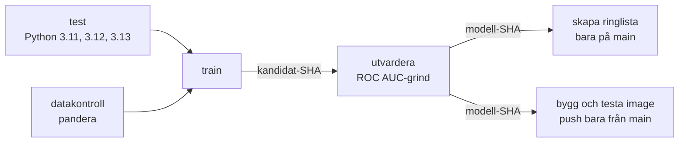

# Saldes Mobil – churn-pipeline


Saldes Mobil AB är ett fiktivt telebolag, och all kunddata i repot är påhittad. Projektet förutsäger
vilka kunder som riskerar att säga upp sitt abonnemang och gör en **ringlista** till kundtjänst.

Målet är att **bara en testad modell med känd härkomst kan bli en ringlista**. Förut tränades modellen
för hand, ringlistan gjordes manuellt varje måndag, och en sämre modell nådde kundtjänst utan att
någon kunde spåra vilken commit eller vilken data den kom från. Pipelinen i `.github/workflows/ci.yml`
löser det genom att testa, validera, träna, utvärdera, versionera och paketera modellen automatiskt.

> Modellen, datan och feature-koden i `src/churn/data.py` ägs av analysteamet och ändras inte här.
> Arbetet gäller pipeline, tester och inställningar.

## Pipelinen i korthet



| Jobb | Vad det gör | Stoppar pipelinen om |
| --- | --- | --- |
| `test` | Kör testerna på Python 3.11, 3.12 och 3.13 parallellt. `fail-fast: false`, så ett fel på en version avbryter inte de andra | Något test faller |
| `datakontroll` | Kontrollerar datafilen mot ett pandera-schema (`kontroller/schema.py`) | Datan bryter mot schemat |
| `train` | Tränar modellen och laddar upp den som artefakten `kandidat-<sha>` | Träningen kraschar |
| `utvardera` | Laddar ner kandidaten och kör kvalitetsgrinden. Är modellen godkänd sparas den som `modell-<sha>`. Mätvärdena skrivs i körningens **Summary** | ROC AUC är under tröskeln |
| `skapa ringlista` | Skapar `ringlista.csv` från den godkända modellen och laddar upp den som artefakt. Körs bara på `main`, aldrig på pull requests | Ringlistan blir inte skapad |
| `bygg och testa image` | Bygger en Docker-image med den godkända modellen, smoke-testar den och pushar till ghcr.io. Pushen sker bara från `main` | Smoke-testet faller |

`train` väntar på både `test` och `datakontroll`, och allt efter `train` väntar på `utvardera`. En
modell som inte har klarat både testerna och kvalitetsgrinden kan alltså aldrig bli en ringlista eller
en image.

### När körs pipelinen?

- **Vid push och pull request**, men bara om något av följande ändrats: `src/`, `data/`, `tests/`,
  `kontroller/`, `pyproject.toml`, `.github/workflows/`, `.github/actions/`, `Dockerfile` eller
  `.dockerignore`. En ändring som bara rör README startar ingen körning.
- **Varje måndag kl. 06:00 svensk tid** (schemat står i `ci.yml`).
- **Manuellt** med knappen *Run workflow* i fliken Actions. Där kan man välja vilken datafil som ska
  kontrolleras.
- **En ny push på samma gren avbryter den pågående körningen** (`concurrency`). Andra grenar påverkas inte.

### Återanvändbar installation

Alla jobb installerar projektet på samma sätt, så installationen ligger på ett ställe: den lokala
composite actionen `.github/actions/installera`. Den installerar Python (med pip-cache som byts ut när
`pyproject.toml` ändras) och projektets paket, med valfria grupper som `dev` och `data`.

## Datavalidering

`kontroller/schema.py` kontrollerar bland annat att `kund_id` är unikt, att åldern ligger mellan 18
och 100, att `region` och `abonnemang` har tillåtna värden, att kostnader och antal inte är negativa
och att inga okända kolumner finns (`strict=True`).

```bash
python kontroller/schema.py data/kundbas.csv                # godkänd
python kontroller/schema.py data/kundbas_ny_leverans.csv    # STOPPAD, avslutar med felkod
```

Pipelinen stoppar vid schemafel, och `kundbas_ny_leverans.csv` är en exempelfil som ska stoppas.

## Versionering och spårbarhet

Varje tränad modell får en fraktsedel i `outputs/matvarden.json`:

| Fält | Betyder |
| --- | --- |
| `roc_auc`, `accuracy` | Hur bra modellen var på testdatan |
| `commit` | Commitens SHA, alltså exakt vilken kod som tränade modellen (`lokal` vid körning på egen dator) |
| `datafil` | Vilken datafil som användes |
| `data_sha256` | Datafilens kontrollsumma, alltså exakt vilken data |

Modellfiler ligger **inte** i Git (`models/`, `*.joblib` och `outputs/` är ignorerade). I stället
sparas de som artefakter med commitens SHA i namnet:

- `kandidat-<sha>`: nytränad modell som ännu inte är godkänd. Sparas i 1 dag.
- `modell-<sha>`: godkänd modell. Det är den som ringlistan och imagen bygger på.
- `ringlista-<sha>`: ringlistan, skapad från `modell-<sha>`.

Den som undrar varför en ringlista blev som den blev kan gå från ringlistans SHA till modellen, och
därifrån till både commit (koden) och kontrollsumma (datan).

## Kvalitetsgrind

`python -m churn.evaluate` läser `matvarden.json` och avslutar med felkod om **ROC AUC är under 0,70**.
Tröskeln kan ändras med miljövariabeln `MIN_ROC_AUC`.

Vi använder ROC AUC och inte accuracy, eftersom ungefär 81 % av kunderna är kvar. En modell som
alltid gissar att ingen slutar får redan 0,81 i accuracy utan att kunna något. ROC AUC mäter hur väl
modellen rangordnar de som slutar före de som stannar, vilket är det ringlistan behöver.

> **[Teamet: skriv med egna ord varför just 0,70 är en rimlig gräns.]**

## Tester

Testerna ligger i `tests/` på tre nivåer:

| Nivå | Fil | Exempel |
| --- | --- | --- |
| Kod | `test_features.py` | Regionnamn med versaler, som `STOCKHOLM`, blir `Stockholm`, och indata ändras inte |
| Data | `test_data.py` | Förväntade kolumner finns, målvariabeln är binär, `kundbas.csv` följer schemat och den nya leveransen stoppas |
| Modell | `test_model.py` | Modellkontrakt, reproducerbarhet, ROC AUC över tröskeln och modellen slår en `DummyClassifier` |

## Köra lokalt

```bash
python -m venv .venv && source .venv/bin/activate   # Windows: .venv\Scripts\activate
pip install -e ".[dev,data,api]"

pytest                                   # testerna
python kontroller/schema.py data/kundbas.csv   # datakontroll
python -m churn.model                    # tränar, skriver outputs/modell.joblib och outputs/matvarden.json
python -m churn.evaluate                 # kvalitetsgrind, felkod om ROC AUC är under tröskeln
python -m churn.score                    # skriver outputs/ringlista.csv
```

## Docker och API

Imagen bygger på `python:3.11-slim`, kör som en vanlig användare (inte root) och innehåller modellen från
`outputs/`. Den innehåller ett FastAPI-API:

| Sökväg | Gör |
| --- | --- |
| `GET /health` | Visar att tjänsten lever, och vilken commit och vilken ROC AUC modellen har |
| `POST /predict` | Tar emot en kund och returnerar risken att kunden slutar (0–1) |
| `GET /ringlista?antal=10` | De kunder som har högst risk |

Kör lokalt (träna modellen först så att `outputs/` finns):

```bash
docker build -t saldes-churn .
docker run -p 8000:8000 saldes-churn
curl http://localhost:8000/health
curl -X POST http://localhost:8000/predict -H "Content-Type: application/json" \
  -d '{"alder": 30, "region": "Stockholm", "abonnemang": "Bas", "manader_som_kund": 2,
       "manadskostnad": 149.0, "data_gb_per_manad": 5.0, "supportarenden_12m": 3}'
```

I pipelinen taggas imagen med commitens SHA, aldrig `latest`:
`ghcr.io/jazzuss/saldes-mobil-lab-alpha:<sha>`. Efter bygget körs ett smoke-test som startar
containern, anropar `/health` och `/predict` och kontrollerar att risken ligger mellan 0 och 1. Först
när det har gått igenom, och bara på `main`, pushas imagen.

## Så arbetar vi

- `main` är skyddad. Ingen pushar direkt, och varje pull request granskas av en teamkamrat innan den
  slås ihop.
- Varje ändring görs på en egen gren (`feat/...`, `fix/...`) och går via en pull request.
- Commit-meddelanden förklarar varför, med en kort titel och ett par meningar om avvägningen.

## Vad som finns här

| Sökväg | Innehåll |
| --- | --- |
| `data/kundbas.csv` | 2 000 kunder: ålder, region, abonnemang, kostnad, dataförbrukning, supportärenden och om kunden avslutat (`avslutat`) |
| `data/kundbas_ny_leverans.csv` | Exempel på en ny dataleverans som datakontrollen ska stoppa |
| `src/churn/` | `data.py` (inläsning och features), `model.py` (träning), `evaluate.py` (kvalitetsgrind), `score.py` (ringlista), `api.py` (FastAPI) |
| `kontroller/schema.py` | Datakontrollen med pandera |
| `tests/` | Tester på tre nivåer |
| `Dockerfile`, `.dockerignore` | Paketering av modellen och API:et |
| `.github/workflows/ci.yml` | Pipelinen |
| `.github/actions/installera/` | Återanvändbar installation av Python och paket |
| `arenden/` | Kursens övningsärenden |

## Team

- [jazzuss](https://github.com/jazzuss)
- [norelindkvist-debug](https://github.com/norelindkvist-debug)
- [OrhanUlusoy](https://github.com/OrhanUlusoy)

## Hur vi har använt AI

Delar av koden och dokumentationen har tagits fram med stöd av AI. Stegen som är markerade med
`# AI genererat` i `ci.yml` (Summary-steget och smoke-testet) är sådana.

